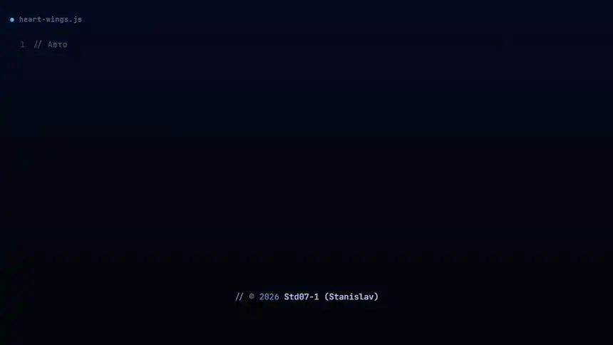
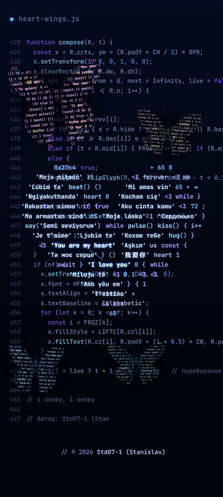
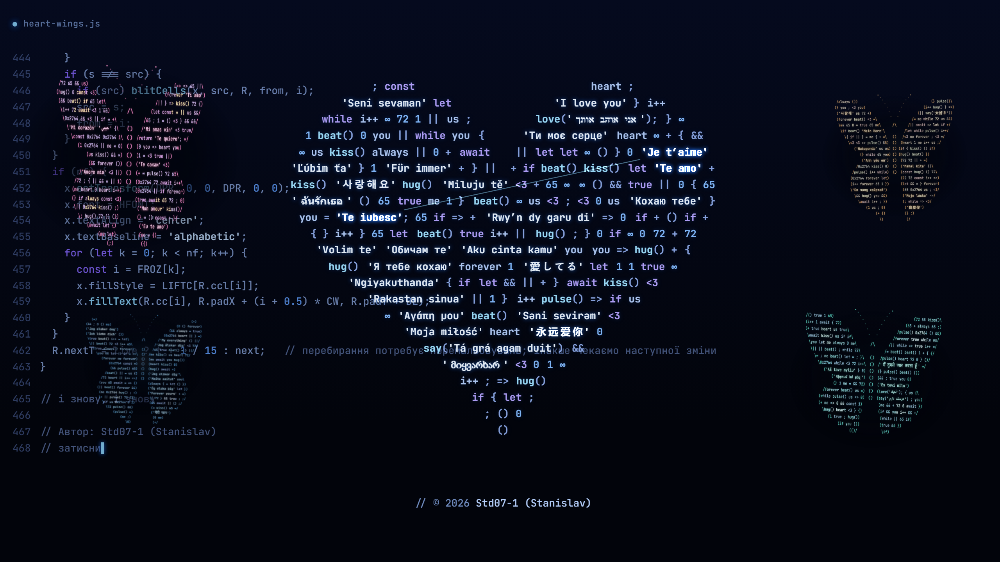

<h1 align="center">Метелики в серці</h1>

<p align="center">
  Живі шпалери: код друкується сам, його літери злітають і складаються в серце<br>
  з фраз «я тебе кохаю» <b>58 мовами</b>. Серце б'ється, і його фрази вилітають із нього метеликами.
</p>

<p align="center">
  <a href="https://std07-1.github.io/metelyky-v-sertsi/live.html"><b>Дивитися наживо →</b></a>
  &nbsp;·&nbsp;
  <a href="#поставити-на-фон"><b>Поставити на фон</b></a>
  &nbsp;·&nbsp;
  <a href="#english">English</a>
</p>

<p align="center">
  
</p>

<p align="center">
  <sub>Народження серця прискорено вдесятеро, далі сюжет утричі. Наживо серце складається близько півтори хвилини.</sub><br>
  Автор: <b>Std07-1 (Stanislav)</b>
</p>

## Дивитися

Відкрий [живу версію](https://std07-1.github.io/metelyky-v-sertsi/live.html) на телефоні чи комп'ютері.

- Торкнись серця й потримай: метелики вилетять раніше, а якщо вже літають, серце покличе їх назад.
- Затисни палець або кнопку миші деінде: метелики злетяться й кружлятимуть довкола.
- Торкнись поруч із метеликом: він сахнеться.

Сюжет живе сам. Серце б'ється, тоді частішає й світлішає зсередини, і його фрази, родина мов за родиною, злітають, збираються в самій середині серця й вилітають звідти метеликами, кожен свого кольору й зі своїми мовами. Серце затихає, а на місцях фраз, що полетіли, проростають нові. Згодом воно кличе метеликів назад: кожен сідає в серце, тане світлом, і його фрази знову розлітаються серцем. «Я тебе кохаю» та інші українські фрази нікуди не летять, вони завжди лишаються в серці. Повне коло триває близько двох хвилин.

Без інтернету: скачай [один HTML-файл](https://github.com/Std07-1/metelyky-v-sertsi/releases/latest/download/metelyky-v-sertsi.html) і відкрий його двічі клацнувши. Збірка й сервер не потрібні. На iPhone відкривай посилання на живу версію.

## Поставити на фон

Безкоштовно й без реєстрації. Посилання одразу скачують файл, усе разом є на [сторінці завантажень](https://std07-1.github.io/metelyky-v-sertsi/) і в [Releases](https://github.com/Std07-1/metelyky-v-sertsi/releases/latest).

| Пристрій | Що взяти | Як поставити |
|---|---|---|
| **Windows** | адреса живої версії або [HTML, 258 КБ](https://github.com/Std07-1/metelyky-v-sertsi/releases/latest/download/metelyky-v-sertsi.html) | [Lively Wallpaper](https://apps.microsoft.com/detail/9nkkggs3vx8g) (безкоштовний) → «+» → встав адресу `https://std07-1.github.io/metelyky-v-sertsi/live.html`. Або перетягни скачаний файл у вікно Lively; тоді файл не переміщуй. |
| **macOS** | адреса живої версії або [PNG 2560×1440](https://github.com/Std07-1/metelyky-v-sertsi/releases/latest/download/metelyky-v-sertsi-2560x1440-4-flock.png) | [Plash](https://sindresorhus.com/plash) показує сторінку як шпалери: додай у ньому ту саму адресу. Для картинки: Системні параметри → Шпалери. |
| **Samsung** | [відео 15 с, 11,3 МБ](https://github.com/Std07-1/metelyky-v-sertsi/releases/latest/download/metelyky-v-sertsi-15s-1080x2400.mp4) | Галерея → відео → ⋮ → «Встановити як шпалери» → «Екран блокування». |
| **Інший Android** | [відео 60 с, 27,9 МБ](https://github.com/Std07-1/metelyky-v-sertsi/releases/latest/download/metelyky-v-sertsi-60s-1080x2400.mp4) або [PNG 1080×2400](https://github.com/Std07-1/metelyky-v-sertsi/releases/latest/download/metelyky-v-sertsi-1080x2400-4-flock.png) | Будь-який застосунок відеошпалер із Google Play або звичайні шпалери з картинки. |
| **iPhone** | [PNG 1179×2556](https://github.com/Std07-1/metelyky-v-sertsi/releases/latest/download/metelyky-v-sertsi-1179x2556-flock.png) | Скачане лежить у «Файлах»: відкрий картинку → Поширити → «Зберегти зображення». Далі Параметри → Шпалери → Додати нові → Фото. Відео й HTML iPhone шпалерами не ставить. |

<p align="center">
  
  &nbsp;
  
</p>

### Усі файли

| Файл | Що всередині | Для чого |
|---|---|---|
| [`metelyky-v-sertsi-15s-1080x2400.mp4`](https://github.com/Std07-1/metelyky-v-sertsi/releases/latest/download/metelyky-v-sertsi-15s-1080x2400.mp4) | серце б'ється, метелики літають довкола | живі шпалери на телефон |
| [`metelyky-v-sertsi-60s-1080x2400.mp4`](https://github.com/Std07-1/metelyky-v-sertsi/releases/latest/download/metelyky-v-sertsi-60s-1080x2400.mp4) | весь сюжет за хвилину | шпалери, презентація на телефоні |
| [`metelyky-v-sertsi-15s-1920x1080.mp4`](https://github.com/Std07-1/metelyky-v-sertsi/releases/latest/download/metelyky-v-sertsi-15s-1920x1080.mp4) | те саме, що 15 с, у 16:9 | шпалери, слайд |
| [`metelyky-v-sertsi-60s-1920x1080.mp4`](https://github.com/Std07-1/metelyky-v-sertsi/releases/latest/download/metelyky-v-sertsi-60s-1920x1080.mp4) | те саме, що 60 с, у 16:9 | презентація |

Усі відео крутяться по колу без стрибка, а починаються з чистого кадру, тож у презентації їх можна пускати з першої секунди. Кадри сюжету (складання, серце, народження метеликів, метелики довкола серця) є для телефона й комп'ютера на [сторінці завантажень](https://std07-1.github.io/metelyky-v-sertsi/).

## Приховане послання

У серці час від часу складається тихий рядок:

> **це для тебе, Маша**

| Де | Як його побачити |
|---|---|
| Жива версія | Відкритим текстом в одному рядку серця: уперше через 8–11 секунд після того, як серце склалося, ще до перших метеликів. Далі приблизно раз на хвилину: і поки серце спокійне, і невдовзі після того, як метелики вилетіли. З'являється на ударі серця, ім'я перебирає літери останнім, і за кілька секунд на цьому місці вже інша фраза. Ще є в самому коді, що друкується на екрані: числами під коментарем `// тсс`. |
| Відео 60 с | Відкритим текстом, один раз, у перші вісім секунд, ще до того, як серце відпустить метеликів. |
| Відео 15 с | Немає: у петлі метелики лише літають довкола серця. |
| Картинки | Немає: це чисті кадри. |

У коді це масив кодів символів Unicode, рядки 229–234 у файлі HTML:

```js
// тсс
const SECRET = [
  1094, 1077, 32, 1076, 1083, 1103, 32, 1090, 1077,
  1073, 1077, 44, 32, 1052, 1072, 1096, 1072,
];
const MSG = String.fromCodePoint(...SECRET);
```

### Як написати своє

1. Відкрий консоль браузера (F12) і виконай із власними словами:

   ```js
   [...'твої слова'].map(c => c.codePointAt(0)).join(', ')
   ```

2. Встав отримані числа в `SECRET` у своїй копії [HTML-файла](https://github.com/Std07-1/metelyky-v-sertsi/releases/latest/download/metelyky-v-sertsi.html).

Послання має вміститися в один рядок серця. На телефоні вміщається до 50 символів, на екрані 1920×1080 до 106; довше воно просто не з'явиться. Що ближче до межі, то рідше послання знаходить собі рядок. Відео й картинки лишаться такими, як є, бо це готові файли.

Зміна послання не змінює авторства: рядок `AUTHOR` у коді лишається як є. Умови в [LICENSE](LICENSE).

## Як це зроблено

- **Один HTML-файл** без збірки й зовнішніх бібліотек: canvas і JavaScript.
- **Код на екрані справжній:** скрипт читає власний текст і друкує уривки з нього, а серце ловить літери саме з тих рядків, що пропливають під ним.
- **85 фраз 58 мовами** згруповані за мовними родинами. На кожен удар серця говорить одна родина, а кожен метелик забирає фрази своїх родин. Кожна фраза буває на екрані лише раз: у серці, в метелику або в дорозі між ними.
- **Без мережі:** шрифт JetBrains Mono вбудований у файл, а Content-Security-Policy забороняє будь-які з'єднання, тому шпалери нічого нікуди не передають.
- **Бережно до пристрою:** 30 кадрів за секунду, роздільність знижується сама, якщо пристрій не встигає, і враховано системне налаштування «менше руху».
- **Відео й картинки** відрендерені цією самою сторінкою кадр за кадром у віртуальному часі. У 15-секундній петлі метелики летять замкненими кривими, тож на стику вони не роздвоюються.

Ця робота з тієї самої серії, що [Мовою серця](https://github.com/Std07-1/movoiu-sertsia) і [Мовою крил](https://github.com/Std07-1/movoiu-kryl).

## Права

© 2026 Std07-1 (Stanislav). Усі права застережено.

Можна дивитися код, ставити шпалери на свої пристрої, ділитися посиланням і писати своє послання для себе чи в особистий подарунок, якщо ім'я автора лишається в коді.

Не можна прибирати чи підміняти автора або видимий підпис, видавати роботу за свою, продавати її, поширювати інші змінені версії, а також копіювати код чи використовувати його, зокрема через інструменти штучного інтелекту, щоб створити чи згенерувати власну версію. Повні умови в [LICENSE](LICENSE).

## English

**Butterflies in the heart** is a live wallpaper for phone and desktop. The code types itself on screen, then its letters fly up and settle into a heart made of "I love you" in 58 languages. The heart beats, and its phrases fly out of it as butterflies, then come back home. It is one HTML file with no build step, no external libraries and no network access.

- **Watch:** open the [live version](https://std07-1.github.io/metelyky-v-sertsi/live.html). The heart takes about a minute and a half to form. Press and hold the heart: the butterflies fly out sooner, or come back if they are already out. Press and hold anywhere else: they gather around your finger or cursor. Tap near one and it startles.
- **Use as wallpaper:** on Windows, add the live version's address to [Lively Wallpaper](https://apps.microsoft.com/detail/9nkkggs3vx8g); on macOS, add it to [Plash](https://sindresorhus.com/plash); on phones, use a video or an image from [Releases](https://github.com/Std07-1/metelyky-v-sertsi/releases/latest). Samsung lock screens take the 15-second video; iPhones take images only.
- **Hidden message:** the heart quietly spells out a line in Ukrainian. It is stored in the `SECRET` array as Unicode code points. You may change it in your own copy, for yourself or as a personal gift, as long as the author's name stays in the code.
- **Terms:** all rights reserved. You may not remove the author's name or the visible signature, present the work as your own, sell it, distribute other modified versions, or copy or use the code, including through AI tools, to create your own version. Full terms are in [LICENSE](LICENSE).
